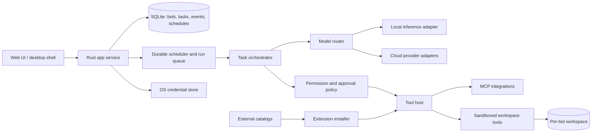

# Open-source AI teammate platform

**Status:** Product direction and remaining roadmap; implemented features are documented in README.md.
**Name:** Teammate

## Implemented in 0.3

The desktop app has guided setup, appearance controls, persistent teammate profiles and tasks, local and cloud model adapters, bounded agent runs, private workspace files, durable approvals, GitHub and Slack integrations, MCP over HTTP and stdio, browser setup, an Ollama download library and a vision companion bridge. Version 0.3 added routines, delegation between teammates, time-limited computer control, the plugin marketplace with signed catalogs, and background tray mode. The README and CHANGELOG describe tested behaviour and current limits.

Remaining work: readable approval previews and edit-before-approve, step-level progress inside a run, embedded inference, a macOS build, Wayland input, signed installers, shared team accounts and remote access.

## Product

Build a self-hostable team of persistent AI teammates. A person gives a bot an outcome, and the bot can work through the task across connected apps, files, and a persistent workspace; pause for approval when needed; and return a result that can be reviewed. Bots can keep user-controlled context, run scheduled routines, and hand work to other bots.

The product is a durable task system with an AI model behind it. Chat is how people direct and review work; it is not the product's core abstraction.

## Product principles

- **User-owned:** Run on a personal computer, home server, or VPS. The owner chooses where data and workspaces live.
- **Model choice:** Use supported local models, cloud models with the user's API keys, or compatible self-hosted model endpoints.
- **Persistent work:** Each bot has a profile, editable memory, integrations, a durable workspace, and an activity history.
- **Reviewable autonomy:** Show what the bot is doing. Ask before sensitive or irreversible actions. Let the owner pause, cancel, or take over.
- **Open extension points:** Import integrations and routines, and install them from more than one catalog.

## Core concepts

| Concept | What it contains |
| --- | --- |
| **Bot** | Name, role, instructions, model profile, memory, connected tools, permissions, and workspace. |
| **Task** | Goal, conversation, status, run history, files, outputs, and any open decisions. |
| **Run** | One resumable attempt at a task, with model/tool events and resource usage. |
| **Integration** | A connected app or tool, with its own credentials and granted actions. |
| **Routine** | A reusable workflow with a trigger, allowed actions, and approval policy. |
| **Catalog item** | An integration, routine, bot template, model source, or UI theme with publisher and version metadata. |

## Main user flows

1. **Create a bot:** Pick a role, model, memory behavior, integrations, and autonomy rules.
2. **Assign work:** State an outcome, attach files or links, and optionally set a deadline or schedule.
3. **Follow progress:** Read a live task timeline; inspect tool calls, files, and decisions; pause or take over the workspace.
4. **Approve decisions:** Review a proposed action with its target and effects, then approve, edit, or reject it.
5. **Reuse work:** Save a successful task as a routine, or hand a subtask and its relevant artifacts to another bot.
6. **Install extensions:** Import an integration or routine by package/catalog URL, inspect its permissions, then enable it.

## v1 boundary

Start as a **single-owner, local-first product** with one or more bots. It should keep working while the host computer or server is online. A deployment on a VPS can stay available when a laptop is closed. Shared team accounts, billing, hosted multi-tenant compute, and a first-party mobile app can follow later.

The first “bot computer” is a persistent, isolated workspace with files, a browser session, and a controlled set of commands/tools. It is not unrestricted access to the owner's whole desktop. Add optional host-computer access later behind a separate, revocable permission.

## Architecture

### Rust services

- **App service:** Local web API, authentication for remote access, settings, and event streaming.
- **Task orchestrator:** Durable task state machine; streams model output; invokes tools; records events; checkpoints and resumes runs.
- **Scheduler:** Starts one-off and recurring tasks. A task can be queued, running, waiting for approval, paused, completed, failed, or canceled.
- **Model router:** Selects a provider/model by bot profile and task capability. A small app-owned provider contract keeps provider details out of task logic.
- **Tool host:** Lists available tools, checks permissions before calls, executes integrations, and returns typed results.
- **Workspace runner:** Owns each bot's persistent files and browser profile; exposes only explicitly granted file, browser, and command actions.
- **Storage:** SQLite for application state and event history; normal files for model artifacts and bot workspaces. Keep secrets out of SQLite and logs.

Keep the first deployment as one Rust service and one SQLite database. Add a separate worker or queue service only when concurrent workloads make the single-process scheduler a bottleneck.

### Model support

Treat **downloading a model** and **running a model** as separate capabilities:

- A model source adapter discovers repository metadata, files, revisions, gated access, and the model's stated license. Downloads are resumable, pinned to a revision, and checked against published hashes where available.
- A runtime adapter reports which file formats, architectures, modalities, and hardware it can execute. The UI must distinguish “downloaded” from “runnable here.”
- Start with a practical format/runtime combination such as GGUF through a Rust runtime, plus a generic OpenAI-compatible endpoint for local servers. Add more formats and runtimes as real demand arrives.
- Offer native adapters for major cloud APIs and a generic OpenAI-compatible adapter for other hosted providers. Capabilities such as tools, images, and streaming are declared per model rather than assumed universal.
- Store each provider key in the operating system credential store. Bots receive access only to the provider connection selected for them; plugins do not get model-provider secrets by default.

### Shared tools across local models

Computer use, Chrome/browser control, MCP, files, and connectors belong to the **agent runtime**, not to a specific model vendor. The runtime should expose one common tool catalog to every local model and translate calls into the selected model's native function-call format when available. For local models without native tool calling, use a constrained structured-action adapter and validate every proposed action before execution.

Vision has an extra requirement: a text-only model cannot interpret screenshots or image content by itself. Route image and screen understanding to an optional local vision model, then return its description to the selected local model. This keeps the workflow local while letting text-only models use computer tools. When no vision model is installed, mark screenshot-dependent actions unavailable and offer browser/DOM or accessibility-tree tools where possible. Do not claim equal tool reliability across models; show the active model/helper route and keep the same approval policy around actions.

“Download any open-source model” is a product goal, not something one runtime can guarantee. Model repositories use different licenses, weight formats, architectures, and hardware requirements. The app should let users browse and download compatible artifacts while clearly showing license and execution support; it must not imply that every open-weight model is OSI-approved or runnable on every machine.

### Integrations and marketplace

- Use **MCP** as the first interoperability layer for app integrations and tool servers.
- Give each integration its own credentials, allowed actions, and network scope. The model sees only tools the bot is permitted to use.
- Require an approval policy for sends, purchases, publishing, deletion, and other sensitive changes. Show the action and target before approval.
- Support local import and multiple catalogs from the start. A catalog is a signed or hash-pinned index, not a privileged code path.
- Catalog entries can describe MCP integrations, bot templates, routines, and model sources. Native code must never be loaded into the main Rust process. If a first-party plugin SDK is needed, add a sandboxed WASM runtime as a later extension type.
- Show publisher, version, source, permissions, and update changes before install or upgrade. Removing an integration revokes its credentials and access.

### Memory and routines

- Separate **task history** from **bot memory**. History is an audit trail; memory is a small, editable set of facts/preferences the bot may reuse.
- Show the source and timestamp for saved memories. Let the user inspect, edit, export, and delete them.
- A routine stores a clear trigger and steps/constraints. The first run should be supervised; subsequent autonomy follows the bot's permission rules.
- Bots collaborate through explicit task handoffs with selected context and artifacts, not by silently sharing every conversation or credential.

## Safety and control model

Every tool call goes through one policy check. Permissions are scoped by bot, integration, action, and (where possible) resource. The activity feed records the request, decision, result, and files changed.

Use three clear action modes:

1. **Ask every time** for sensitive or irreversible actions.
2. **Ask once per routine or scope** for actions the owner pre-approves.
3. **Run automatically** for low-impact, reversible work within a stated scope.

Keep pause, cancel, disconnect, credential revoke, workspace inspection, and memory deletion available to the owner. Tool output and web pages are untrusted input; they cannot change the bot's permissions or approval rules.

## Suggested implementation sequence

1. **Durable bot/task core:** Rust app service, SQLite schema, bot profiles, task timeline, streaming chat, pause/cancel/resume.
2. **Model choice:** One local runtime path, provider API-key storage, one cloud adapter, generic compatible endpoint, model capability display.
3. **Shared agent tools:** Common tool loop, local-model structured-call adapter, controlled browser/Chrome, workspace files, screenshot and accessibility-tree inputs.
4. **Safe integrations:** MCP import, per-tool permissions, approval queue, event audit.
5. **Always-on behavior:** Scheduled and recurring tasks, restart recovery, notifications, retry limits and budgets.
6. **Vision bridge and team of bots:** Local vision helper for text-only models; explicit handoff and parallel subtasks with shared artifacts and per-bot access controls.
7. **Catalogs:** External registries, install/update UX, publisher verification, extension SDK after the first integration needs are known.

The smallest credible MVP is **one persistent bot that can take a task, use one local/cloud model, work in its isolated workspace, ask before consequential actions, and resume after a restart**. Build multi-bot collaboration and a public marketplace on that foundation.

## Decisions to confirm later

- Product name and license. The initial source release uses Apache-2.0; third-party model weights and plugins keep their own licenses.
- Initial user: one person running a private instance, or a small self-hosted team.
- First local runtime and model formats.
- Which first integrations matter most.
- Whether remote access is supported in v1, and how the owner exposes the private instance safely.

## Reference points

- [Grok Bot product overview](https://x.ai/bot)
- [OpenAI Dot help and controls](https://help.openai.com/en/articles/20001530-getting-started-with-your-dot)
- [Rig Rust LLM provider contracts](https://docs.rs/rig-core/latest/rig_core/)
- [mistral.rs local model quickstart](https://docs.mistralrs.dev/quickstart/)
- [Hugging Face model download guide](https://huggingface.co/docs/huggingface_hub/en/guides/download)
- [MCP tools specification](https://github.com/modelcontextprotocol/modelcontextprotocol/blob/main/docs/specification/2026-07-28/server/tools.mdx)
