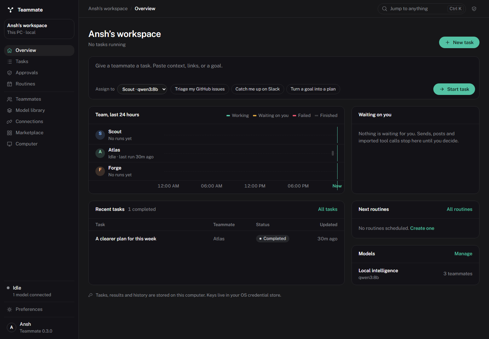

# Teammate

An open source desktop workspace for AI teammates, built with a Rust runtime and Tauri. Give a teammate a goal, follow its work, review proposed actions, and keep the result on your device.



## What works in 0.2

- **Guided setup:** name your workspace, choose local or cloud intelligence, connect services, and set your style.
- **Personalization:** dark, light, and system themes; custom accent colors; text size; density; typography; corner radius; compact navigation; reduced motion; start page; preferences import and export.
- **Persistent teammates:** editable names, roles, instructions, colors, individual model connections, and private file workspaces.
- **Real task execution:** native tool calls or a JSON action adapter, task activity, cancellation, bounded runs, saved results, Markdown export, and durable approval continuation.
- **Model choice:** OpenAI compatible Chat Completions and Responses endpoints, including Ollama, LM Studio, OpenRouter, Groq, and OpenAI. Use your own API keys. Responses history preserves reasoning items across tool calls.
- **Local model library:** inspect an Ollama runtime, download supported model tags (including supported Hugging Face GGUF tags), follow progress, cancel, and connect installed models. Ollama must be installed and running separately.
- **GitHub:** verify an account, browse up to 100 accessible repositories, read up to 50 open issues per repository, and create issues after approval.
- **Slack:** verify a workspace, list up to 100 accessible public/private channels, read up to 50 recent messages, and send messages after approval.
- **MCP extensions:** import remote MCP configuration, discover Streamable HTTP tools, keep sessions between actions, and review imported calls before execution. Includes a setup guide for Microsoft’s Playwright MCP browser server.
- **Vision bridge:** send MCP tool images directly to an image capable model, or use an explicitly selected vision companion to describe images for text models. No model gains image understanding merely by enabling a setting.
- **Local persistence and credentials:** SQLite stores profiles, tasks, decisions, and connection metadata. Windows Credential Manager / Linux Secret Service stores keys separately.
- **Windows and Linux packages:** Windows NSIS installer; Linux Debian and AppImage packages.

The UI screenshots use illustrative test data. The desktop app starts with editable teammate profiles and your own empty workspace.

## Start using it

1. Install the package for your OS. On Windows the app uses WebView2; the installer can provision the runtime. On Linux use a desktop session with WebKitGTK 4.1 and a working Secret Service keyring.
2. Complete guided setup, or choose **Explore first** and connect services later.
3. For local intelligence, start [Ollama](https://ollama.com/download) or LM Studio. Use **Model library** to download an Ollama model, then **Use this model**. For cloud intelligence, open **Connections** and supply the provider’s API base URL and key.
4. Choose **Discover**, select a model, and verify the connection. The first model is assigned to teammates that do not already have one.
5. Give a teammate a task. Review the activity and any exact action payload in **Approvals**. Results can be copied or exported as Markdown.

For local models without native function calling, try **Structured actions** in the connection’s tool settings. The model must still be capable of following the JSON action instructions. **Text only** disables tool calling.

### GitHub and Slack

GitHub uses a personal access token. Grant metadata and issues read access for the repositories you want to use; add issues write access if you want approved issue creation. Existing token permissions determine what is accessible.

Slack uses a bot or user token. Typical scopes are `channels:read`, `groups:read`, `channels:history`, `groups:history`, and `chat:write`. Invite the app to the channels it should read. Slack workspace policy and token scopes may limit access.

### Browser tools

Install Node.js and start a [Playwright MCP server](https://github.com/microsoft/playwright-mcp):

```sh
npx @playwright/mcp@latest --port 8931
```

In **Extensions → Set up browser tools**, connect `http://localhost:8931/mcp`. Keep the server running. Browser state is retained between tool calls. Text models can work with accessibility snapshots; screenshot interpretation requires a vision capable connection or companion.

### Importing extensions

Use **Extensions → Import extension** with either format:

```json
{ "name": "My tools", "url": "http://localhost:8931/mcp" }
```

```json
{ "mcpServers": { "browser": { "url": "http://localhost:8931/mcp" } } }
```

The app shows the endpoint for review and verifies it before saving. Enter tokens separately in the connection form. Command based stdio servers need an HTTP bridge; the app does not execute commands from imported manifests.

## Current boundaries

This is an early usable desktop release. It does not yet bundle a native host computer controller, a model inference engine, an autonomous scheduler, a signed plugin marketplace, or every vendor’s proprietary API. Computer tools are available when provided by a compatible MCP server. The extension library is an import and connection surface; it is not a package registry or a claim that arbitrary plugins are compatible.

Model quality and tool reliability vary. A weak text model may not reliably perform an agent workflow. A vision companion supplies descriptions, with the usual image interpretation limitations. No inference model is bundled, and downloads follow the model runtime’s supported formats and licenses.

External services and cloud models receive the context needed for the action. A vision companion receives tool images when configured. Local storage is not encrypted by the app; OS key storage protects credentials separately. Workspace path checks are intended to prevent accidental file escape, not to sandbox an untrusted native extension. Imported MCP tools may have broad access on the server; review their inputs and run only servers you trust.

Tasks pause on app restart and can be run again. An interrupted model download can resume cached layers through Ollama. GitHub/Slack browsing currently shows bounded first pages rather than complete account exports. Disconnecting a connection pauses active task runs. The desktop process must stay open for tasks to continue.

## Build from source

Install Rust stable, Node.js 22+, and the [Tauri platform prerequisites](https://tauri.app/start/prerequisites/). On Windows use the Visual Studio x64 Native Tools prompt with C++ Build Tools and a Windows SDK. Linux needs WebKitGTK 4.1, GTK, DBus development headers, and the packages listed in the CI workflow.

```sh
npm ci
npm run dev
```

```sh
# On Windows
npm run build:windows

# On Linux
npm run build:linux
```

Packages are written to `src-tauri/target/release/bundle`. CI builds Windows x64 and Ubuntu 22.04 x64 packages. Locally built Linux preview packages use Ubuntu 24.04. The Windows bundle uses the system webview and does not ship Chromium. Model weights and separate tool runtimes are additional downloads.

### Checks

```sh
cargo test --manifest-path src-tauri/Cargo.toml
npx playwright install chromium
npm run test:ui
```

Rust checks cover settings, migrations, credential storage, endpoint validation, model adapters, workspace files, image routing, MCP sessions, and full task/approval continuation. Browser UI tests explicitly mock the native command boundary. They cover setup, errors, connections, teammates, tasks, downloads, extensions, vision settings, persistence, keyboard navigation, and responsive layouts.

Optional live checks are ignored by default. `TEAMMATE_TEST_GITHUB_TOKEN` enables the GitHub read-only check; `TEAMMATE_TEST_MCP_URL` plus a local preview enables the browser check. Never put credentials in source or shell history.

After a Windows release build, `npm run test:native` launches the real WebView2 desktop app in an isolated temporary workspace. It checks setup, Rust IPC, model discovery, a file write, exact approval, an MCP call, and the saved result using a deterministic local HTTP fixture. It does not require a paid model key or change your normal workspace.

### Storage

The default location is the OS application data directory for `dev.localteam.teammate`. To choose a different local workspace, set `TEAMMATE_DATA_DIR` to an absolute directory before launching. This changes the database and file workspace location; credentials remain in the OS credential store.

## License

[Apache-2.0](LICENSE). Model weights, external tools, and services retain their own licenses and terms.
