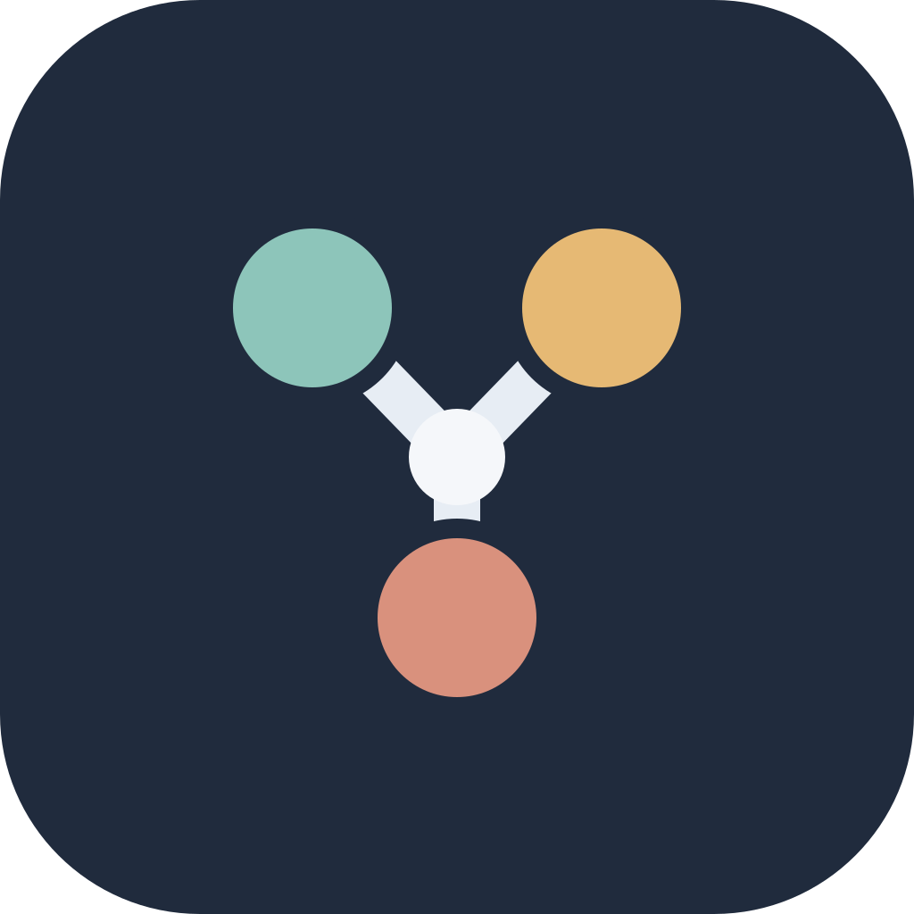
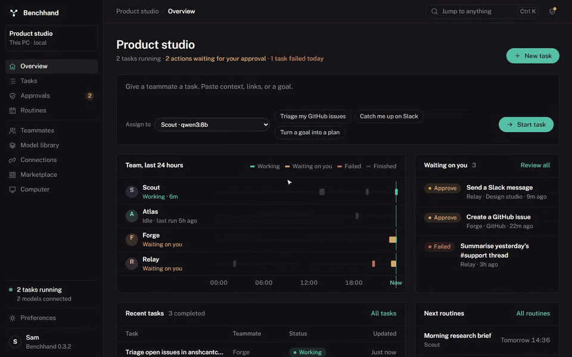
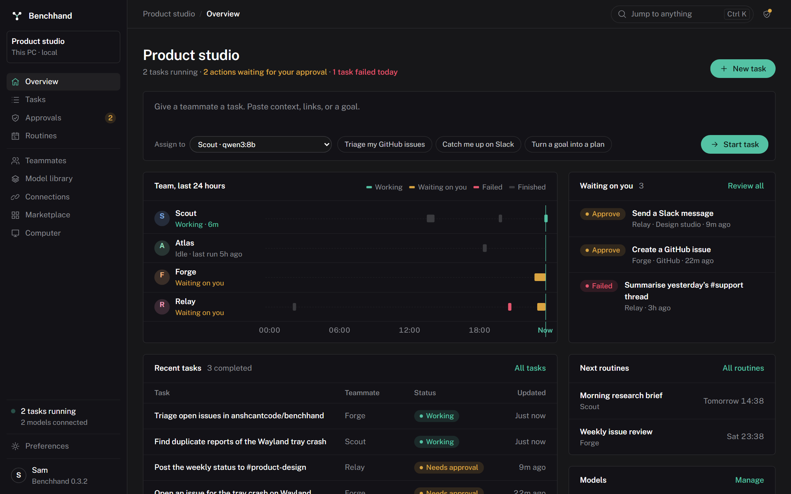
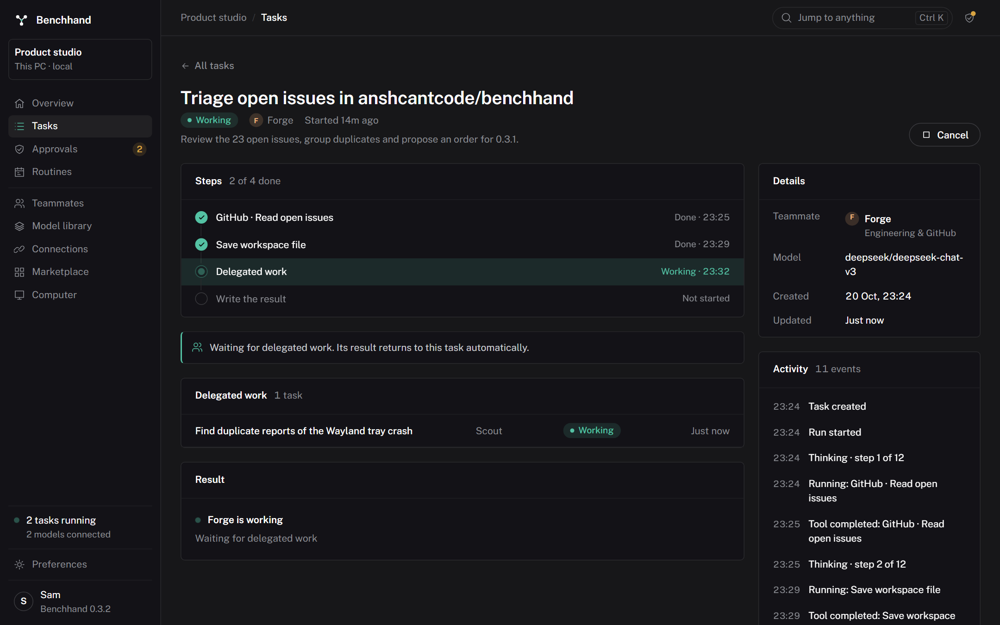
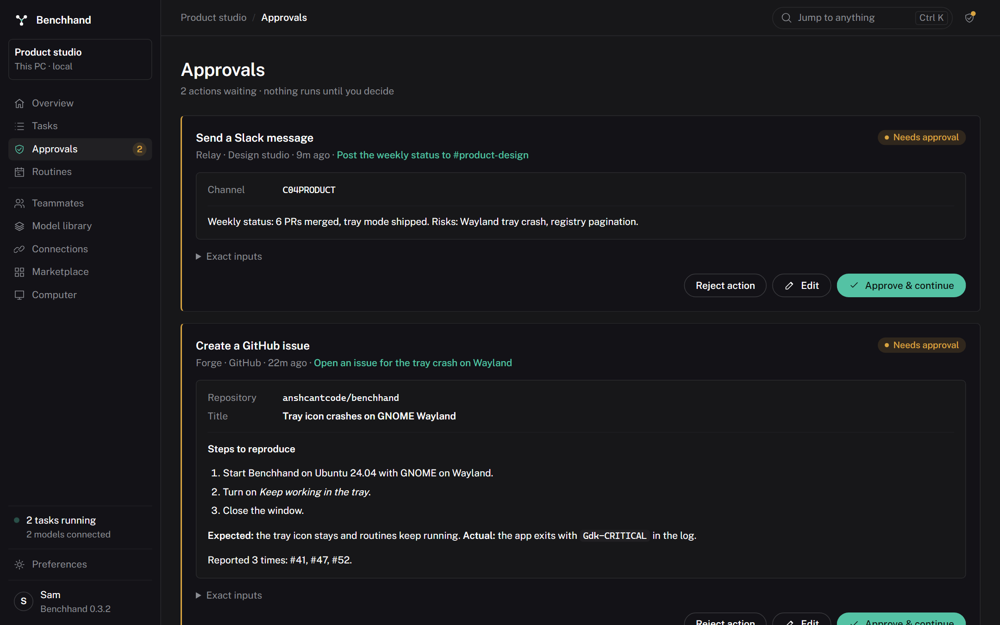
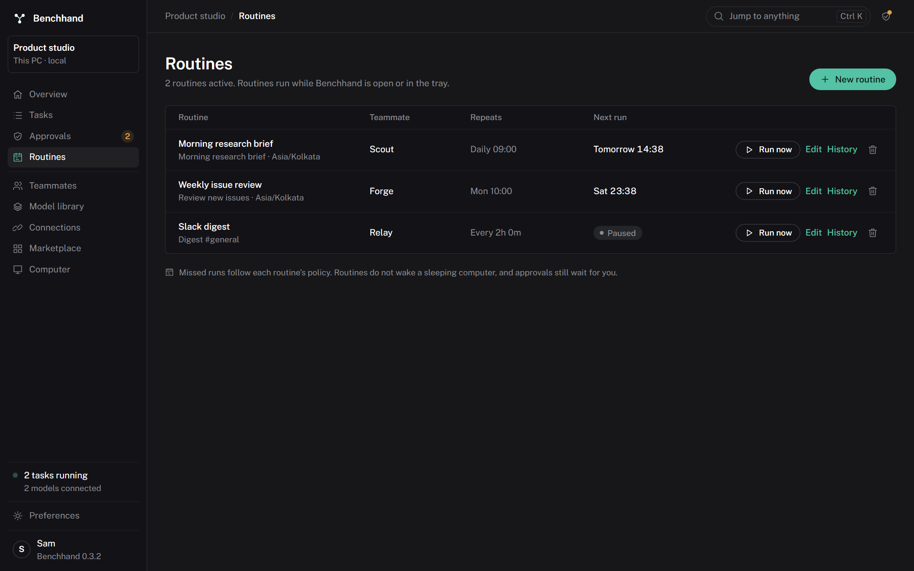
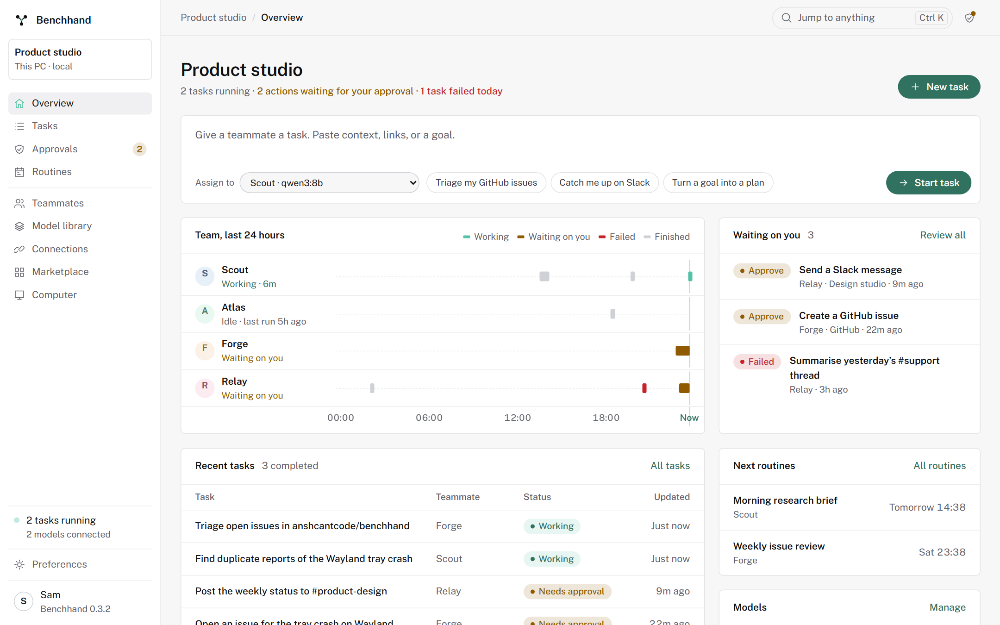
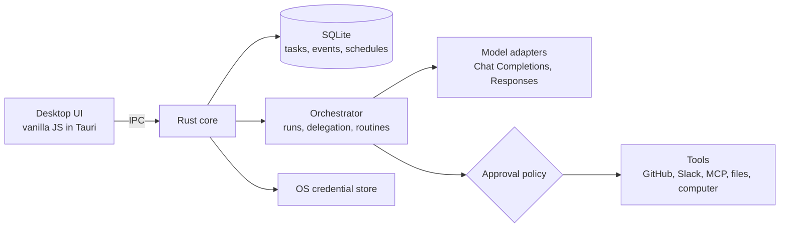

<div align="center">



# Benchhand

**A small team of AI bots that runs on your own computer.**
Give a teammate a goal, watch the work happen, and approve anything that leaves the machine.

[](https://github.com/anshcantcode/benchhand/actions/workflows/desktop.yml)
[](https://github.com/anshcantcode/benchhand/releases)
[](LICENSE)

[](CONTRIBUTING.md)

<sub>Formerly Teammate. Existing installs keep their data; see the <a href="CHANGELOG.md#upgrading-from-teammate">upgrade notes</a>.</sub>

[Download](https://github.com/anshcantcode/benchhand/releases) · [User guide](docs/USER_GUIDE.md) · [Contributing](CONTRIBUTING.md) · [Plugins](docs/PLUGINS.md) · [Roadmap](PRODUCT_DESIGN.md)

</div>



<p align="center"><sub>Sample data. Every send, post or imported tool call waits here until you approve, edit or reject it.</sub></p>

## Why Benchhand

Most AI tools are a chat box. Benchhand is a **durable task system**: each teammate has a role, its own model, instructions and private workspace. Tasks survive restarts, teammates hand work to each other, routines run on a schedule, and every send, post or imported tool call stops in an approval queue until you decide.

- **Local first.** Tasks, results and history live in SQLite on your machine. Keys live in the OS credential store, never in prompts.
- **Your models.** Ollama, LM Studio, vLLM, OpenAI, OpenRouter, Groq, or any OpenAI-compatible endpoint, chosen per teammate.
- **Reviewable autonomy.** You see the exact payload of every consequential action before it runs.
- **Open tools.** MCP servers over HTTP and stdio, a marketplace with signed community catalogs, and teammate packs.

## Features

| | |
| --- | --- |
| **Teammates** | Editable name, role, instructions, colour, model and private file workspace for each bot. |
| **Tasks** | Native tool calling or a JSON action adapter for small local models; a step list for every run, live activity, cancel, re-run, Markdown export. |
| **Approvals** | Slack messages, GitHub issues, computer input and MCP calls shown as they will appear, with the exact JSON one click away. Edit values before you approve. |
| **Delegation** | Teammates discover each other and create child tasks. A shared turn budget, depth limit and loop detection keep runs bounded. |
| **Routines** | Once, interval, daily and weekly schedules with IANA time zones, daylight saving handling and missed-run policies. |
| **Model library** | Browse, download and connect Ollama models, including Hugging Face GGUF tags, with progress and cancellation. |
| **Connections** | GitHub, Slack, and Streamable HTTP MCP servers, with secrets in Windows Credential Manager or Linux Secret Service. |
| **Marketplace** | Featured tools, Official MCP Registry search, signed catalogs, exact-version review, managed npm installs, updates and uninstall. |
| **Computer control** | Time-limited, per-teammate screen capture and approved input. Stop at any time with Ctrl+Alt+Escape. |
| **Vision bridge** | Send tool images to a vision model, or let a vision companion describe them for text-only models. |
| **Background work** | Optional tray mode and sign-in startup, so routines keep running with the window closed. |
| **Personal** | Dark, light and system themes, accent colour, density, text size, corner radius and compact navigation. |

<table>
  <tr>
    <td colspan="2"></td>
  </tr>
  <tr>
    <td></td>
    <td></td>
  </tr>
  <tr>
    <td></td>
    <td></td>
  </tr>
</table>

<sub>Screenshots use sample data. A new install starts with editable teammate profiles and an empty workspace.</sub>

## Get started

1. **Download** the Windows installer, Debian package or AppImage from [Releases](https://github.com/anshcantcode/benchhand/releases).
2. **Connect a model.** Start [Ollama](https://ollama.com/download) and download a model from **Model library**, or add a cloud provider key in **Connections**.
3. **Give a teammate a task** from the overview, then follow it in **Tasks** and decide in **Approvals**.

The [user guide](docs/USER_GUIDE.md) covers GitHub and Slack tokens, computer control, plugins, routines, delegation and current limits.

## How it works



| Path | What lives there |
| --- | --- |
| `src-tauri/src/main.rs` | App setup, settings, storage, migrations and IPC commands |
| `src-tauri/src/agent.rs` | The agent loop, tool calling and approval continuation |
| `src-tauri/src/orchestration.rs` | Concurrent runs, delegation trees and routines |
| `src-tauri/src/services.rs` | Model turns, GitHub, Slack and MCP clients |
| `src-tauri/src/models.rs` | The Ollama model library and downloads |
| `src-tauri/src/marketplace.rs` | Catalogs, signatures, plugin installs and updates |
| `src-tauri/src/stdio.rs` | Managed MCP server processes |
| `src-tauri/src/computer.rs`, `desktop.rs` | Native screen capture and input; tray and sign-in startup |
| `frontend/` | The interface: `app.js`, `features.js`, `styles.css`, no framework |
| `tests/` | Playwright interface tests against a mocked native boundary |

## Build from source

You need Rust stable, Node.js 22+ and the [Tauri prerequisites](https://tauri.app/start/prerequisites/) for your OS.

```sh
npm ci
npm run dev
```

```sh
npm run test:rust   # Rust runtime checks
npm run test:ui     # Interface checks (run `npx playwright install chromium` once)
npm run build:windows   # or build:linux
```

Packages are written to `src-tauri/target/release/bundle`. See [docs/VALIDATION.md](docs/VALIDATION.md) for the native end-to-end check and platform notes.

## Contributing

Contributions of every size are welcome: bug reports, docs, new integrations, model adapters, and interface polish. Start with [CONTRIBUTING.md](CONTRIBUTING.md), then pick an issue labelled [`good first issue`](https://github.com/anshcantcode/benchhand/labels/good%20first%20issue) or [`help wanted`](https://github.com/anshcantcode/benchhand/labels/help%20wanted).

Areas where help makes the biggest difference:

- **Integrations:** Linear, Jira, Notion, Google Drive and email through MCP.
- **Platforms:** a macOS build and Wayland portal testing.
- **Models:** native adapters for more providers and better structured-action prompts for small local models.
- **Packaging:** signed Windows installers and Flatpak.

Please read the [code of conduct](CODE_OF_CONDUCT.md). Report security issues privately as described in [SECURITY.md](SECURITY.md).

## License

[Apache-2.0](LICENSE). Model weights, external tools and services keep their own licences and terms.
