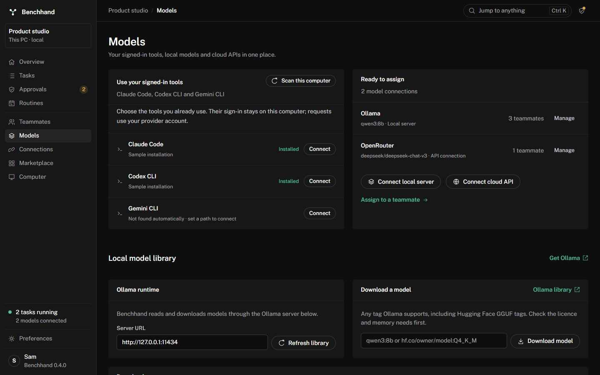
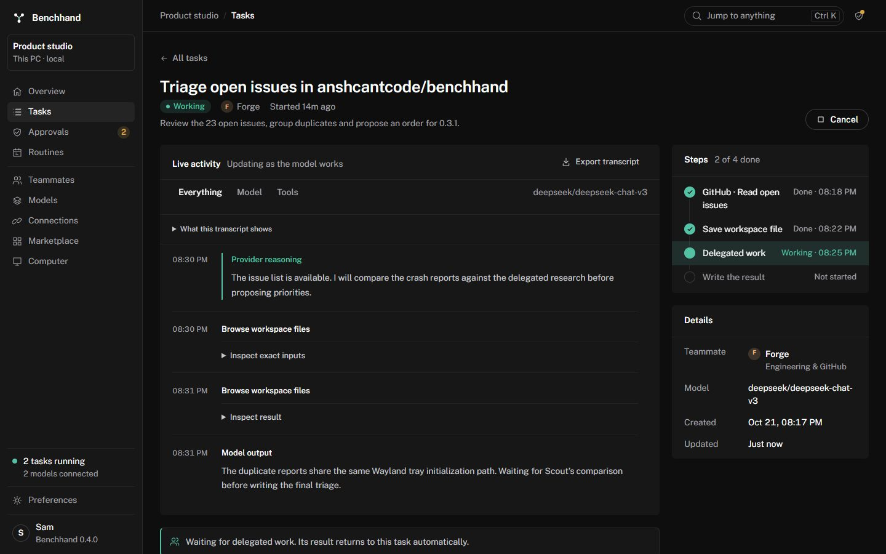

# Models and live activity

## Use an account already signed in on this computer

Open **Models → Use your signed-in tools**. Scan this computer, connect the client, then use **Assign to a teammate** to choose its model connection. Each teammate may use a different connection. Choose `default` to let the CLI select its default model, or type a model ID your account can access.

| Client | Before connecting | Transport |
| --- | --- | --- |
| Claude Code | Install the official CLI and complete `claude auth login` in a terminal. | Print mode with streaming JSON; native tools, configured MCP servers and hooks disabled for the invocation. |
| Codex CLI | Install the official CLI and complete `codex login` in a terminal. | `exec` with JSON events, an ephemeral session, read-only sandbox, shell and delegation disabled, no user configuration or web search. |
| Gemini CLI | Install the official CLI and run `gemini` in a terminal to choose authentication and sign in. | Streaming JSON, no extensions, invocation-scoped deny-all native-tool policy, hooks disabled and an empty MCP allowlist. |

These use the installed CLI's supported automation interface. Benchhand does not read or copy login tokens, imitate a web session, or convert a subscription into an unrestricted API key. Model access, account eligibility, quotas and billing remain with the provider. Connecting checks that the executable starts; the first task verifies actual account/model access. A version or installation check alone does not establish sign-in.

Use **Executable location** when automatic discovery fails. Point it at the native executable or installed JavaScript entry file; Windows `.cmd`, `.bat` and PowerShell shims are not supported. JavaScript entry files run through Node directly. Restart Benchhand after installing a new CLI so it inherits the updated PATH. Recent versions are required; unsupported flags fail with an update instruction.

The adapter sends conversation context and available Benchhand tool schemas as text. The model returns a structured action, which Benchhand executes through its ordinary tool/approval runner. This keeps GitHub, Slack, MCP, delegation and computer permissions in the same workflow regardless of the model transport. Client-specific plugins, native CLI tools and existing CLI conversation history are not imported. Reliability depends on the chosen model following the action format.

CLI connections currently accept text context. To interpret screenshots or other tool images, configure an image-capable **Vision companion** in Preferences. That companion receives the images and supplies descriptions. A model turn has a five-minute CLI timeout; cancelling its task drops and stops the directly launched process. Each turn starts a fresh CLI invocation with the Benchhand conversation included; large conversations have a 2 MB transport limit.

*Sample data shown in the preview.*

## Local and cloud models

**Models → Ready to assign** lists every connected model and how many teammates use it. Connect a local server or cloud API from that section. The local library below it retains Ollama download, progress, cancellation and model selection. API credentials remain in the OS credential store.

Cloud API endpoints use Chat Completions or Responses. Streaming responses show output incrementally; servers returning ordinary JSON show it when the response arrives. For a compatible reasoning model using Responses, enable **Request reasoning summaries** in the model connection. Some models do not support that option; disable it if the provider rejects the parameter.

## See what happened

Open a task's **Live activity**. It records:

- The selected connection/model, context message count, available tool count and turn number.
- Model output as the provider publishes it. This is unverified until confirmed by a tool result.
- Provider-published reasoning or reasoning summaries where available. Private internal thinking and encrypted reasoning payloads are not displayed.
- Exact proposed tool inputs and returned results, with expandable payloads. Very large results and image bytes are omitted from the activity copy.
- Turn timing and token usage when the transport reports usage.
- Approval, delegation, completion and failure status.

Filter **Everything**, **Model** or **Tools**. Expanded tool payloads and transcript scroll position survive live updates. **Export transcript** downloads JSON containing the task and its recorded events. Old tasks keep their existing status history; detailed events begin with runs made in this version.

Activity is persisted with task history in local SQLite. It can include task prompts, file contents, tool payloads and model output; exports can contain the same data. The current model connection's secret is redacted from new activity details. This is not a general secret scanner: avoid putting unrelated credentials in task/file content.

*Sample task data and provider output shown in the preview.*

## Troubleshooting

- **Not found automatically:** choose the executable path, check Node for npm installations, and restart Benchhand after PATH changes.
- **Sign-in or access failure:** run the same CLI and selected model in a terminal. Complete sign-in or resolve its usage/model restrictions there, then retry the task.
- **No visible reasoning:** the provider did not publish it. Benchhand does not invent a thinking transcript.
- **Tools fail to run:** check the teammate's connected services and computer permissions, inspect the exact action/error, and try a model that reliably follows structured actions.
- **Interrupted stream:** the task reports an error instead of silently treating partial output as a completed answer. Review the transcript before retrying.

## Interface references

The adapters follow the official [Claude Code CLI reference](https://code.claude.com/docs/en/cli-reference), [Codex non-interactive documentation](https://learn.chatgpt.com/docs/non-interactive-mode), [Gemini headless interface](https://geminicli.com/docs/cli/headless/) and [Gemini policy engine](https://geminicli.com/docs/reference/policy-engine/).
